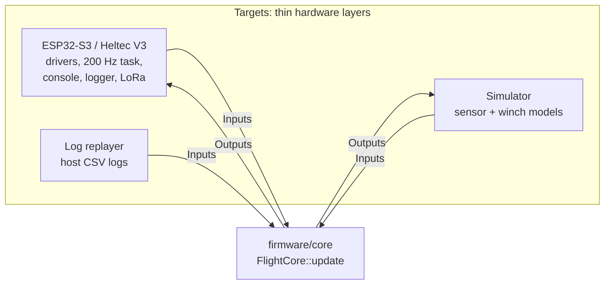
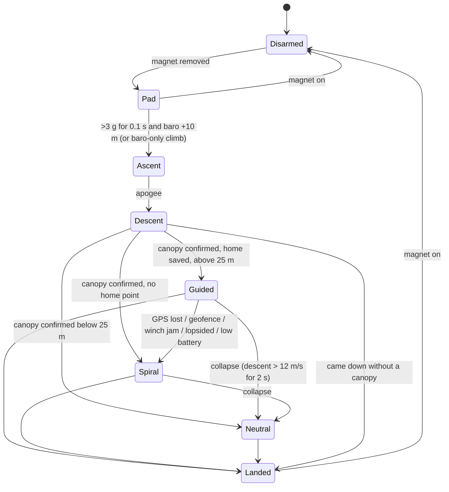

# Architecture

## Layers

`firmware/core` is the OS. It's plain C++17 with no hardware calls, and the
same sources build for the desktop simulator and the ESP32. Each target fills
an `Inputs` frame every 5 ms and gets back an `Outputs` frame:

- **Inputs:** IMU, barometer, GPS fix, encoder counts, arming switch, battery.
- **Outputs:** two motor duties, motors enabled, buzzer, LED.

That's the spec's "thin hardware layer" pattern, as used by ArduPilot's SITL.

## Inside FlightCore (200 Hz)

| Stage | Module | What it does |
|---|---|---|
| Estimate | `AltitudeFilter` | Barometric height and climb rate (Kalman); rejects ejection pressure spikes |
| | `AttitudeFilter` | Gravity direction only (Mahony). Turns gyro rates into turn rate about the vertical. The accelerometer is ignored between launch and canopy |
| | `GeoOrigin` | GPS → metres from home |
| | `WindEstimator` | Least-squares circle fit of GPS ground velocity while turning: centre = wind, radius = airspeed. Refined on straight legs. No compass |
| Detect | `PhaseDetector` | Launch (accel + baro confirm), burnout, apogee, **canopy confirmed** (mean descent over the last 3 s within 1.5–9 m/s for 2.5 s after a jolt, or 7 s without one; with `canopy.mainalt` set, only below the main altitude and only a jolt below it counts), landed |
| Guide | `Guidance` | Homing → Loiter (orbit home to burn height) → Final (turn in when the straight glide uses the remaining height; trim with symmetric brake; S-turns if high) → Flare |
| Steer | `Steering` | Turn-rate PI with feedforward. A Kalman filter learns canopy turn gain and bias → lopsided detection |
| Actuate | `WinchController` | Position loop per winch, 6 V cap on a 2S pack, stall / wrong-way detection, idle exercise |
| Supervise | `FlightCore` | Phase logic and guardrails, log records (50 Hz), telemetry (2 Hz) |

## Flight phases

- **Motors:** unpowered in Disarmed (except bench commands), Pad, Ascent and
  Descent.
- **Home point:** averaged from good, stationary GPS fixes on the pad. It is
  frozen the instant a launch is suspected, and nothing can change it in
  flight. There is no uplink.
- **Spiral:** a slow steady turn on held brakes, kept close to where the
  fault happened:
  - jammed winch: toward the jammed side if it is stuck pulled in;
  - lopsided canopy: counter-braked so the turn stays slow.

## Restart recovery

Every cycle the ESP32 target copies a 40-byte checksummed `ResumeState` into
RTC memory, which survives brownout, watchdog and crash resets but not
power-off. It holds the stage, home point, ground pressure, faults and winch
positions.

After such a reset, `FlightCore::resume()` acts on the saved stage:

| Saved stage | What it does |
|---|---|
| Ascent, Descent | Continues detecting, with the saved home point |
| Canopy | Neutral: both brakes released, no more steering that flight |
| Anything else | Ordinary boot |

## Hardware in the loop (gate 4)

`gr::hil` (core) defines the USB frames and the board side of the loop
(`HilBoard`). The ESP32 target and `grhil`'s stand-in board run that same
code, so the protocol is tested without hardware.

Each frame the PC sends sensors, and the board answers with motor commands and
real encoder counts. The board's magnet is a physical interlock: the winches
only move once it is removed.

## Simulator (sim/)

| Piece | What it models |
|---|---|
| `World` | Truth: rocket boost/coast with weathercocking; single or dual deploy (drogue, main altitude, ejection-timing error); ejection charge shocks and pressure transients; canopy inflation and opening shock; parafoil flight; winch DC-motor model with line load, back-drive and jams |
| Parafoil | The spec's simple model: airspeed, sink and turn rate vs. differential and symmetric brake; turn lag; bank-angle sink; pendulum swing. Accelerometer readings are pendulum-consistent |
| `WindField` | Power-law shear, veer with height, Gauss-Markov gusts; gust and shear faults |
| `SensorSuite` | IMU noise, bias and ±24 g / 2000 dps saturation; barometer noise, drift and static-port error at speed; GPS at 10 Hz with latency, wandering bias and outages (including during boost); encoder quantisation; battery sag |
| `Scenario` | Every random choice for one flight, from a seed. Runs are reproducible: `grsim single --seed N` |
| Runners | `runSimple` (gate 1: guidance on truth, ideal brakes) and `runSitl` (gate 2: the full stack) |

The spec's open question was simulator language: Python or Rust. The answer
here is **C++**, the same language as the firmware, so software-in-the-loop
needs no bindings. 1,500 full flights from pad to touchdown take about 15 s
on 4 cores, fast enough for every commit.
