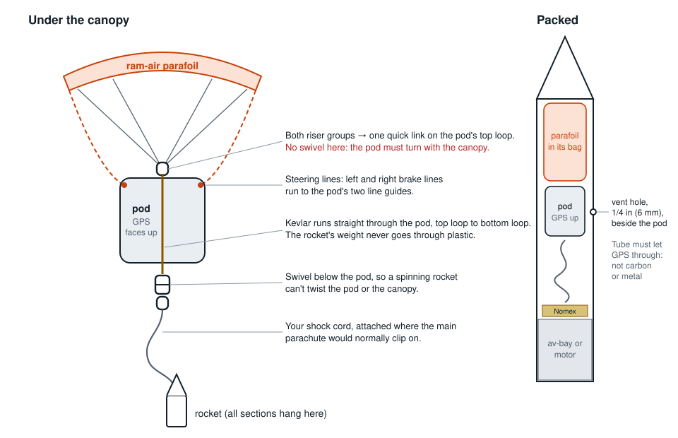

# Fitting the pod to your rocket

The pod needs **no wiring to your rocket**. It rides in the recovery bay with
the parafoil and becomes the link between the parafoil and the rest of the
rocket. Your flight computer, motor ejection, charges and shock cords stay as
they are. This guide covers what does change:

1. [The recovery train](#1-the-recovery-train): where the pod goes.
2. [Deployment setups](#2-deployment-setups): motor ejection, an altimeter,
   dual deploy, a chute release band, and the one setting each needs.
3. [The airframe](#3-the-airframe): GPS through the tube, a vent hole,
   arming, space, mass and stability.
4. [Radio](#4-radio): keeping clear of your tracker.
5. [The optional "main fired" wire](#5-optional-the-main-fired-wire),
   flight computer by flight computer.
6. [Checks at the pad](#6-checks-at-the-pad).
7. [Reference rockets](#7-reference-rockets): kits that fit, and the two the
   test flights use.

Fly the test gates first (bench, ground deploys, drops, low power; see
[BUILD_GUIDE.md](BUILD_GUIDE.md#7-before-the-first-flight)), and fly under
your club's rules and the NAR/Tripoli codes.

## 1. The recovery train



- **Where it clips in:** wherever your main parachute would attach to the
  shock cord, the pod's **bottom** loop attaches instead. Every section of
  the rocket hangs from that point, as it would from a main.
- **Above the pod:** both riser groups of the parafoil go to one quick link
  on the pod's **top** loop. **No swivel here:** the pod must turn with the
  canopy, or the brake lines wrap.
- **Below the pod:** a **swivel**, then a quick link, then your shock cord. A
  rocket that spins under the canopy then can't twist the pod or the canopy
  (strong twist is one of the things that makes the pod give up steering;
  see FEASIBILITY.md, stress).
- **Brake lines:** the parafoil's left and right steering lines run to the
  pod's two line guides. Rig them just slack with the winches at zero (build
  guide, section 7).
- **Load path:** a Kevlar strap runs straight through the pod from the top
  loop to the bottom loop. The rocket's weight and the opening shock never
  pass through plastic.
- **Shock cord, Nomex, shear pins:** as you use them now. Protect the
  parafoil bag and the pod from the ejection gases with a Nomex blanket or
  deployment bag, as you would a main.

**Packing order** (from the end that opens): the parafoil in its deployment
bag, then the pod with its top (GPS) end toward the opening, then the shock
cord, then Nomex. The bag leaves first and pulls the pod out after it.
Rehearse this in ground deployment tests (gate 5) before any flight.

## 2. Deployment setups

| Setup | The parafoil comes out | Set on the pod | Notes |
|---|---|---|---|
| Single deploy, motor ejection | at the ejection delay, near apogee | nothing: `canopy.mainalt 0` (default) | Choose the delay for apogee: a parafoil opened fast can tear. Long descents drift far in wind aloft; above about 600 m in a 10 mph wind the pod may not get all the way back (FEASIBILITY.md, known limits) |
| Single deploy from an altimeter at apogee | at apogee | nothing | As above, with a better-timed opening |
| Dual deploy: drogue at apogee, parafoil as the main | at your main altitude | `set canopy.mainalt <main altitude, m above the pad>` | **Required.** The drogue must fall faster than 12 m/s. A main at 150–250 m gives the pod time to steer and stays below most wind aloft |
| Chute release band (e.g. Jolly Logic Chute Release) around the bagged parafoil | at the band's release altitude | `set canopy.mainalt <release altitude, m>` | No ejection jolt, so the pod confirms the canopy on the slower path (about 7 s of canopy-like descent). Untested with a parafoil bag: ground-test that the band holds and releases it |

The settings are in metres above the pad; `params` shows them, `save`
keeps them. If the canopy opens below 25 m the pod doesn't steer: it leaves
the brakes off.

## 3. The airframe

### GPS and radio through the tube

The pod learns its home point (the pad) from GPS **while it is packed inside
the rocket on the rail**. Its GPS and radio must see out through the
airframe.

| Material | GPS and radio | Source |
|---|---|---|
| Cardboard / kraft | pass through | Featherweight GPS Tracker manual ("RF-transparent, such as fiberglass or cardboard") |
| Fiberglass | pass through; the usual choice for tracker bays | Featherweight, Eggtimer Eggfinder FAQ |
| Phenolic, Blue Tube | probably pass through; no manufacturer statement found | test it (section 6) |
| Carbon fiber | **blocked** | Altus Metrum manual ("carbon fiber, which is opaque to RF signals"); Eggfinder FAQ |
| Metal (aluminium tubes, metal bays) | **blocked**; keep metal a few cm from the antenna | Altus Metrum manual; Eggfinder user's guide |

In a carbon or metal recovery bay the pod gets no home point and only ever
spirals (it never guesses a target). Featherweight's advice for its tracker
applies here too: a fiberglass window over the antenna, at least 1 × 1 in.

### A vent hole beside the pod (needed)

The pod's barometer sits in the recovery bay until the parafoil comes out.
If that bay is sealed, the air inside lags the outside pressure on the way
up and under the drogue, and the pod misjudges its height. In simulation
(1,000 flights each, `grsim gate2 --bay-tau`):

| Bay air lags outside pressure by | Land within 30 m | Steered early | Notes |
|---|---|---|---|
| 0 (vented) | 94.5% | 0 | |
| 0.5 s / 1 s | 94.5% / 94.4% | 0 | no measurable cost |
| 2 s | 92.9% | 0 | |
| 5 s / 10 s | 90.3% / 89.4% | 0 | |
| 30 s (nearly sealed) | 50.2% | 0 | 23 launches never detected; the pod stays safe but doesn't steer |

A rough orifice-flow estimate for a 3 × 12 in bay at 150–250 m/s: one
**1/4 in (6 mm)** hole keeps the lag to a few milliseconds; leaks adding up
to a 1 mm hole give 1–2 s; 0.5 mm behaves like a sealed bay. Apogee Rockets
already recommends a 1/8–1/4 in vent in parachute bays, just below the
nose-cone shoulder, to stop trapped air pushing the nose off early. **Drill
one 1/4 in (6 mm) hole in the bay beside where the pod sits.** Don't rely on
leaks at joints and shear pins.

(Finding this also fixed two weaknesses in how the pod checks its barometer
against GPS; see FEASIBILITY.md, item 25.)

### Arming

The pod arms when its remove-before-flight magnet comes off. Two ways to do
it with the rocket closed:

- **Arm at the prep table (simplest).** Pull the magnet, check the pod
  chirps, close the rocket, carry it to the pad. Arming is safe here: the
  winches stay unpowered until the canopy is confirmed (proven for every
  input sequence, TLA+ `MotorsOffInRocket`). Once the rocket sits still on
  the rail, the pod notices it has moved (3 s of fixes more than 25 m from
  where it armed), relearns its home point there, and switches over after
  5 s of good fixes. Check the ground receiver reads `home` under 10 m before
  launch (section 6).
- **Arm on the rail** (if your club wants it). The printed tag is too big
  to pull through a vent. Use a small disc magnet (1/4 × 1/8 in) on a cord
  instead, taped over the pod's magnet flat, with the cord out through a
  3/8 in hole beside it; pull the cord out on the rail. Pack the pod with
  its flat at the hole, and check on the bench that this magnet holds the
  pod disarmed (`status`: `armed no`), since a smaller magnet has less
  reach.

### Space

The pod and the packed parafoil share the recovery bay. The printed pod
([hardware/pod](../hardware/pod/README.md)) is **62 mm across and 124 mm
long**, plus its Kevlar loops, so it fits 2.6 in, 3 in and 4 in tubes, not
54 mm ones (the winches set the width). Common inside diameters: 54 mm tubes
54.2–54.7 mm, 2.6 in 64.8–65.0 mm, 3 in 76.2 mm, 4 in 99.1 mm (LOC, Blue
Tube, Wildman and Madcow listings). In 3 in and larger tubes, wrap the pod in
the Nomex blanket or a foam sleeve so it can't rattle.

### Mass, stability and ejection

- The pod weighs about 220 g (enclosure CAD estimate), plus the swivel,
  quick links and the parafoil. Add them as mass components in the recovery
  bay in OpenRocket or RockSim, and check the stability margin and the motor
  choice against your club's rules. Mass forward of the CG usually helps
  stability, but check.
- More mass in the bay needs more ejection force to push it out. Size the
  charge by ground test (gate 5), as for any new recovery setup.
- Use your usual shear pins: Apogee and PerfectFlite both warn against
  sections separating early under drag or recoil.

## 4. Radio

The pod's telemetry is LoRa, 250 kHz wide, 14 dBm by default, on 915 MHz
(`set radio.mhz`, `set radio.dbm`). The pod doesn't need it to fly; the risk
is the pod drowning out **your tracker** at the ground station.

| Tracker | Band | Clash with the pod? |
|---|---|---|
| Altus Metrum TeleMetrum, TeleMega, TeleGPS | 70 cm amateur, default 434.550 MHz | no (unless you set the pod to 433) |
| Featherweight GPS Tracker | 915 MHz band LoRa | **same band**: move the pod |
| Eggtimer Eggfinder (US) | 902–928 MHz, **default 915 MHz** | **same frequency** by default: move the pod |
| Eggtimer EU/UK versions | 869.425 / **869.525** / 869.625 MHz | close to the pod's 868: keep 1 MHz or more apart |
| BigRedBee 900 MHz LoRa | 900 MHz band, frequency hopping | shares the band; lower the pod's power |
| BigRedBee BeeLine (70 cm APRS) | 70 cm amateur | no |
| Missile Works RTx/GPS | 902–928 MHz | same band: move the pod |

If your tracker is in 902–928 MHz, put the pod at the other end of the band
(for a tracker on 915: `set radio.mhz 925`). Then test on the ground: with
the pod transmitting next to the tracker, the tracker's receiver must still
decode every packet. (Sources: Altus Metrum, Featherweight, Eggtimer,
BigRedBee and Missile Works product pages and manuals.)

## 5. Optional: the "main fired" wire

You don't need this: the pod finds the open canopy by itself (81 of 81 real
flight logs, none early). The wire adds your flight computer's own word that
the main fired, either as extra evidence (`sense.main 1`, the default) or as
a requirement (`sense.main 2`).

### Which flight computers can drive it

You need a **spare** output channel that can be set to fire with the main.
Never share the main charge's channel: an opto across the e-match can show
continuity when the e-match is broken.

| Flight computer | Spare channel? | Set it to | On-time | Notes |
|---|---|---|---|---|
| Altus Metrum TeleMega, EasyMega | yes: A–D | Flight State = Main (descending below the main altitude) | "Pyro Firing Time", default 50 ms: set **1 s** | Low-side switched; pad shows GO above 3.2 V on the channel |
| Featherweight Blue Raven | yes: 3rd or 4th (they are backups by default; you give one up) | the main altitude | 1 s default; **"stay on"** holds it until landing | Low-side switched; continuity needs 3.8 V |
| Missile Works RRC3 | yes: Aux | trigger event Main, output control 1 | 1 s | Low-side ("current sinking") |
| Eggtimer Quasar | yes: AUX | AUX mode Main | 0.1–9 s: set **1 s or more** | Both sides switched. **Won't arm unless every enabled channel shows continuity** |
| Eggtimer Proton | yes: 6 general outputs | same event as the main | 1–9 s | Both sides switched |
| Altus Metrum EasyMini, TeleMetrum; PerfectFlite StratoLoggerCF; Eggtimer Quantum; Missile Works RRC2+ | **no spare** | — | — | skip the wire |
| Altus Metrum EasyTimer | not suitable (no barometer; no main state) | — | — | skip the wire |
| Jolly Logic Chute Release | no electrical output | — | — | set `canopy.mainalt` to its release altitude instead |

The pod needs the signal on for at least 15 ms; 1 s gives margin. These
details come from the manufacturers' manuals and product pages (Altus
Metrum's read in full; the others from their published manuals as quoted by
search). **Check them against your unit's current manual and bench-test
before flight.**

### Wiring

```
 flight computer (av-bay)                         pod (recovery bay)
 spare channel "+" ──►|── R ──┐                   GPIO 33 ◄──── collector
   (opto LED, anode to +)     │                   GND     ◄──── emitter
 spare channel "−" ───────────┘                    (twisted pair along the
                                                    shock cord, with slack)
```

- **Put the opto in the av-bay**, next to the flight computer. Only the
  pod's own low-voltage signal pair then leaves the av-bay. No pyro-battery
  wiring crosses the separation joint, and the two batteries stay isolated.
- **Resistor R** for about 7–8 mA through the LED: 1S LiPo 390 Ω; 2S or 9 V
  1 kΩ; 3S 1.5 kΩ; 4S (16 V) 2 kΩ; ¼ W.
- **The pair to the pod** goes through the av-bay bulkhead like a charge
  lead, then along the shock cord from the av-bay to the pod, taped every
  30 cm with slack at each end. Under the canopy, the pod hangs from that
  same cord, so the wire stays connected.
- **If the wire breaks**, the pod reads "not fired": with `sense.main 1`
  nothing changes. With `sense.main 2` the pod would never confirm the
  canopy, so use 2 only after ground ejection tests show the wire survives.
- **Continuity:** with only the opto on the channel, your flight computer may
  report no continuity (an LED needs about 1 V before it conducts). On units
  that refuse to arm without it (Eggtimer Quantum and Quasar), or if you want
  the check, add a 1 kΩ ½ W resistor across the channel's terminals beside
  the opto branch. Not yet bench-tested: try it on the bench first.
- Check it on the bench: drive the channel (or the opto from a bench supply)
  and `status` shows `main-fired input ON` (BRINGUP.md, 6c).

## 6. Checks at the pad

In addition to the build guide's pad steps:

1. **Before the first flight of a new airframe:** close the rocket with the
   pod inside, set it upright outdoors, and check the ground receiver shows
   `sv` 6 or more and a home point within 5 minutes.
2. With the rocket on the rail: the ground receiver shows phase `PAD` and
   `home` under 10 m. If you armed at the prep table, wait until it does.
3. The vent hole beside the pod is open (not taped over).
4. If the "main fired" wire is fitted: your flight computer's continuity
   report for that channel is what you saw on the bench.

## 7. Reference rockets

The test flights (gates 7 and 8) use two standard kits, so every result
applies directly to anyone who builds the same kit. Any kit that meets these
limits should work:

- **Bay inside diameter at least 64.8 mm** (the pod is 62 mm across):
  2.6 in, 3 in or 4 in tubes.
- **Cardboard, Blue Tube, phenolic or fiberglass** around the pod; not carbon
  fiber or metal.
- **Liftoff mass under about 1.5 kg** with the pod (about 220 g), the
  parafoil (about 150 g, an estimate until the canopy is chosen) and the
  motor. In practice: a kit under about 0.9 kg empty.
- **About 300–380 mm (12–15 in) of clear bay** for the pod, the bagged
  parafoil, the shock cord and the Nomex. This is an estimate; ground
  deployment tests (gate 5) will settle it.

### The picks

| Kit | Bay inside diameter | Kit mass | Liftoff, estimated | Motors | Role |
|---|---|---|---|---|---|
| **AeroTech HV Arcas** (89012) | 2.6 in (65.0 mm) | 22 oz (620 g) | ≈ 1.1 kg | 29 mm, E–G | **First flights (gate 7):** a long body gives a roomy single-deploy bay on motor ejection; no certification needed on G motors under 1.5 kg |
| **Apogee Mako** | 3 in thin-wall kraft (74.4 mm) | 15.9 oz (452 g) | 0.9–1.0 kg; 1.1–1.25 kg as dual deploy | 29 mm, G–H | **Level 1 flights (gate 8):** the lightest 3 in kit, with an Apogee-documented dual-deploy conversion (74 mm bay kit; fit the 38 mm upgrade during the build if you want it) |
| Madcow 2.6" DX3 (K-3126) | 2.6 in (65.0 mm) | 15 oz (425 g) | ≈ 1.0 kg; 1.05–1.15 kg as dual deploy | 29 mm | Its long payload section is sold as the way to dual deploy (Madcow 2.6 in altimeter bay). 1.5 mm clearance per side round the pod |
| LOC Magnum 3" (MAG329) | 3.1 in (76.2 mm) | 22 oz per LOC, 28.6 oz per Apogee: weigh it | 1.1–1.4 kg | 29 mm, G–H | Inexpensive, payload section included; dual deploy needs an LOC bay added |
| LOC Graduator | 2.6 in (65.0 mm) | 13 oz (369 g) | 0.85–0.95 kg | 29 mm, D to Level 1 H | Very light single deploy. LOC still lists it; one retailer says it is discontinued |

Liftoff estimates are kit + 370 g (pod and parafoil) + motor (29 mm G about
0.12 kg, 29 mm H reload about 0.2 kg), before any dual-deploy bay and
altimeter (Apogee's 74 mm bay is 114.5 g empty). An H motor makes the flight
high power: the flyer needs Level 1 certification.

### Kits that don't fit

| Why | Kits |
|---|---|
| Too narrow (2 in or less) | Estes Pro Series II Ascender, Vogel, Majestic; AeroTech Mustang, Arreaux, Barracuda; LOC LaserLOC and 2.26 in IRIS; Wildman Darkstar Jr. |
| Too heavy for 1.5 kg with the pod | LOC-IV, LOC-IV X2, T-LOC 4, 4 in Goblin, 3.1 in IRIS; Madcow Cowabunga XL DD and 3 in fiberglass Twitch; Apogee Zephyr, Invicta, Mega Mako; Wildman 3; Binder 3 in Excel DD (≈ 1 kg empty); ARR Basic Blues 3; most PML kits |
| Blocks GPS and radio | Madcow carbon-fiber DX3 variants |
| Not enough motor | Estes Nike Smoke and Der Big Red Max (E and F only) |

### Checks on a new kit

1. Measure the bay's inside diameter and clear length; weigh the parts.
2. Model it in OpenRocket or RockSim with the pod and parafoil as mass
   components in the bay; check the stability margin and the motor's
   thrust-to-weight against your club's rules.
3. Drill the 1/4 in vent beside the pod (section 3).
4. Closed-airframe GPS test (BRINGUP.md, section 9).
5. Ground ejection test with the pod and the bagged parafoil (gate 5): it
   all comes out, the parafoil opens, the pod survives.

Specs above are from the makers' and retailers' pages as of November 2026,
read through search results rather than directly; stock changes often.
Confirm on the live page before ordering. Sources: AeroTech HV Arcas
(aerotech-rocketry.com, product 89012); Apogee Mako and the 74 mm thin-wall
e-bay kit (apogeerockets.com); Madcow 2.6" DX3 and altimeter bays
(madcowrocketry.com); LOC Magnum 3", Graduator and cardboard airframes
(locprecision.com).
