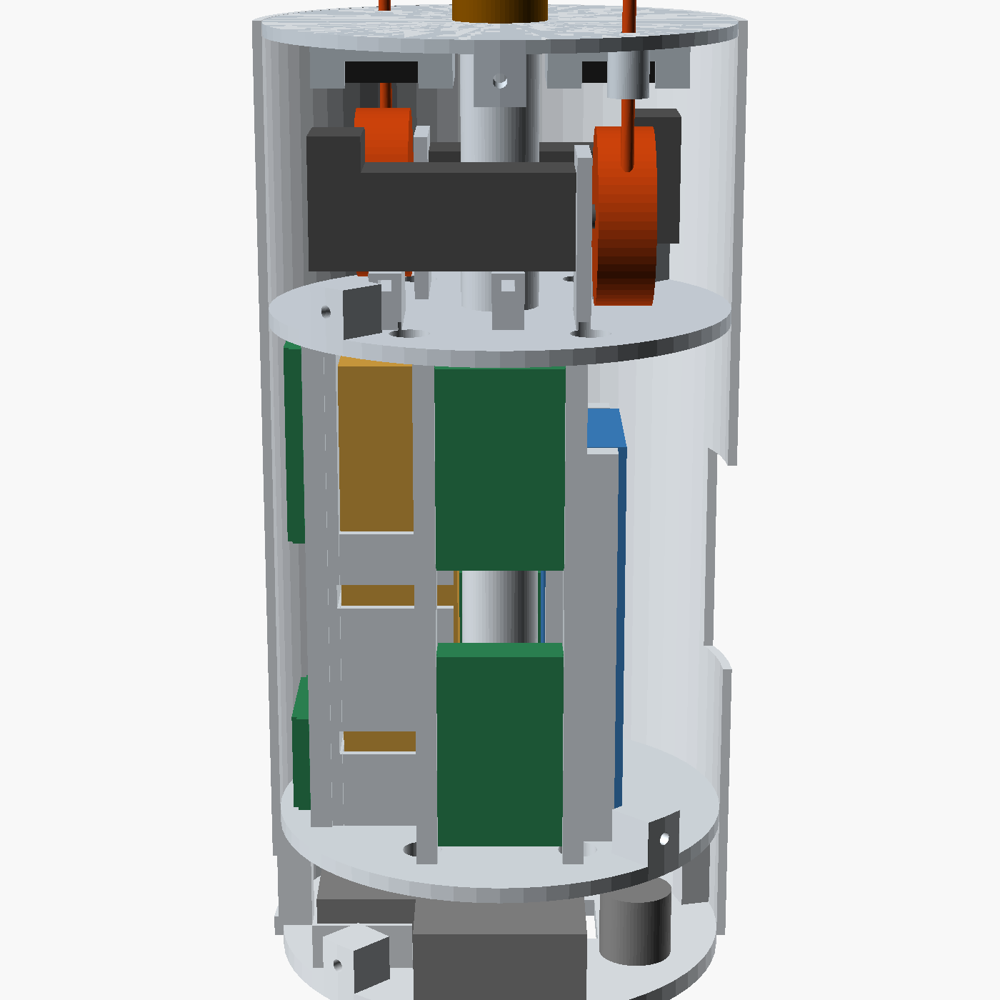
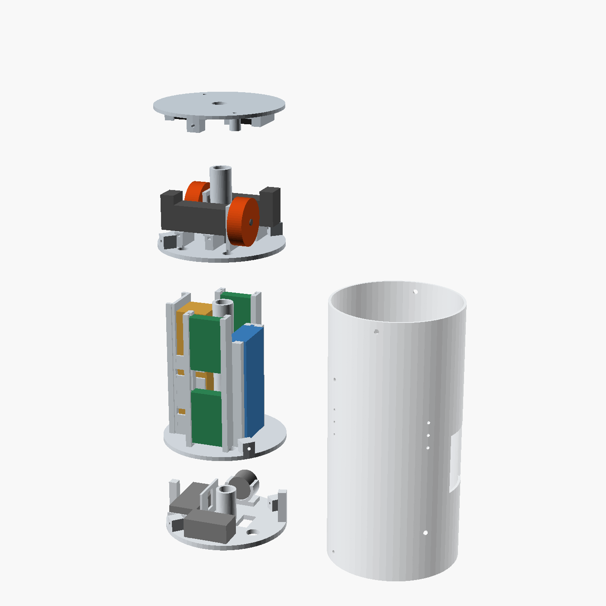

# Pod enclosure (S size), first draft

A printable enclosure for the S pod, drawn in OpenSCAD from the parts' own
dimension drawings and board files, and fit-checked by a script.
**Not printed yet.** Print one, fit the real parts, and report what's off.



| | |
|---|---|
| Outer diameter | **62 mm**: fits 2.6 in (inside 64.8–65.0 mm), 3 in, 4 in tubes; in larger tubes wrap it in the Nomex or a foam sleeve |
| Length | **124 mm**, plus the Kevlar loops |
| Printed parts | about 90 g if printed solid (PETG); 7 parts |
| Whole pod | about 218 g basic, 224 g with the backup kit and the high-g logger (conservative: uses Heltec's listed 35 g for the board) |
| Centre of gravity | 59 mm from the rocket end |
| Fit check | 409 pairs of parts checked with exact mesh booleans: no overlaps; every component at least 0.3 mm inside the sleeve; clear paths for both brake lines, the Kevlar and the USB plug |

**Why not 54 mm tubes?** The winches set the size: each motor is 32.5 mm
long with its encoder, with a 22 mm spool on its shaft, lying across the pod.
`python3 check.py --od 52` shows the motors and spools reaching 28 mm from the
axis against a 24.5 mm limit. A 54 mm pod would need the winches standing
upright with the lines turning through guides. Not drawn yet.

## How it goes together



From the rocket end up, each part sits on the one below and the Kevlar runs
through the hollow spine of all of them:

| Part | Holds |
|---|---|
| **base** | floor with the Kevlar hole, the USB-C port (from below), the antenna's SMA bulkhead; the reed switch (lying flat against the wall, under the RBF magnet flat), the buzzer, the motor-driver watchdog board |
| **sled** | the electronics deck: the Heltec standing on its USB end in edge rails, screen out to the window; the battery in a cradle (hook-and-loop strap through the slots); four breakout slots in grooved rails (+y: DRV8833 above, IMU below; −y: barometer above, second barometer below); outside the battery, the high-g logger and the 5 V regulator |
| **winch** | both gearmotors across the pod on saddles (cable ties) with a face plate at the gearbox (shaft hole and the two M1.6 holes), spools on the output shafts |
| **roof** | GPS pockets under a 1.6 mm plate (patch up; the second is for the backup kit), two PTFE line guides, the top Kevlar hole |
| **sleeve** | slides over the stack; 8 M2 screws into bosses on each part; window for the screen, buzzer holes, barometer vents set 45° away from the sensors so light can't reach them |
| **spool** (×2) | 16 mm drum (matches `winch.cpmm` 50.13), 22 mm flanges, D bore, a hole to tie the line |
| **rbf_tag** | the remove-before-flight tag, holding a 12.7 × 3.2 mm N42 disc magnet |

**Load path.** A Kevlar strap runs straight through the spine, with a loop
at each end: risers above, swivel and shock cord below. A washer under a knot
or sewn stop at each end clamps the stack, so the plastic only ever sees
compression and the rocket's weight and the opening shock stay in the
Kevlar. Real flight logs show opening shocks of 8–35 g (outliers to 140 g):
for a 1.5 kg rocket that's about 0.5 kN, 2 kN at worst. Use a strap rated
well above that through its knots.

**Brake lines** leave each spool straight up to a PTFE tube (2 mm OD) in the
roof, then up to the canopy's steering lines. The two exits are opposite
each other: the pod turns under the risers until they line up with the
canopy's left and right.

## Printing

- PETG or nylon; black or another opaque colour (the barometer is
  sensitive to light).
- Base, sled and winch print upright on their decks; the roof prints upside
  down (plate on the bed); the sleeve upright; no supports needed except the
  screen window's top edge (a 20 mm bridge).
- Decks 100% infill, rails and walls 3–4 perimeters.
- Tap the M2 holes with a self-tapping screw.

## Build and check

```sh
./build.sh            # fit check, then STLs in build/stl
./build.sh --images   # also re-render the pictures (needs xvfb-run)
python3 check.py --od 52   # try another diameter
```

Needs OpenSCAD (2021.01 or later), Python 3 with `trimesh` and `manifold3d`.
CI runs the fit check on every push and keeps the STLs as a build artifact.

## Sources and what to measure first

Sizes from the manufacturers' drawings and board files where they could be
read; the rest from distributor listings. Measure these before printing:

| Part | Envelope used | Source | Confidence |
|---|---|---|---|
| Heltec WiFi LoRa 32 V3 | 50.2 × 25.5 × 10.2; PCB 1.6 with 5.3 above (screen, Wi-Fi antenna) and 3.5 below (battery socket) | Heltec wiki (overall size); third-party KiCad model (heights) | overall size from Heltec; heights unverified |
| Adafruit LSM6DSO32, BMP390, DRV8833, ADXL375 | 25.4 × 17.78 board, 4.5 with STEMMA QT, plus 1 mm of solder behind | Adafruit Eagle files, Fritzing parts, CAD models | from Adafruit's files |
| Pololu D24V10F5 | 17.8 × 12.7 × 3.6 | Pololu listing | listing |
| Pololu 210:1 HPCB with 12 CPR encoder | 10 × 12 × 32.5, side-entry encoder connector, 3 mm D shaft 10 mm | Pololu product pages | listings; the M1.6 face-plate hole spacing (9 mm) is unverified |
| HGLRC M100 Mini | 15 × 15 × 5.2 | HGLRC product page and manual | listing |
| Tattu 2S 450 mAh 75C, **long** version | 61 × 16 × 15 | Tattu (genstattu.com) | listing; the short 45 × 24 version does **not** fit |
| Adafruit 375 reed switch (switch half) | 29 × 14 × 9 | Adafruit listing | listing |
| Same Sky CMI-1295-85T | Ø12 × 9.5 | Same Sky page | listing |
| Bulkhead SMA | Ø6.3 thread, Ø9.5 × 9 body and nut inside | typical part | estimate |
| Watchdog perfboard | 22 × 11.8 × 9.5 | [docs/WATCHDOG.md](../../docs/WATCHDOG.md) parts | estimate: build it to this |

Masses: Heltec as listed (35 g, likely with antenna and headers), battery
28.4 g, motors 11 g each with encoder, the rest from listings; wiring, Kevlar
and hardware estimated at 20 g.
